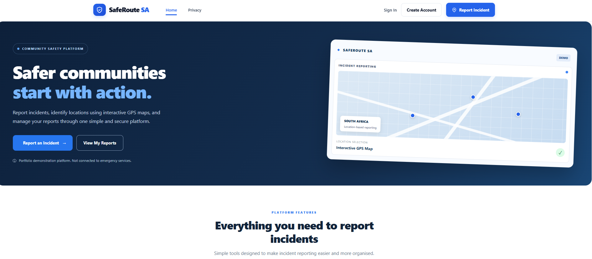
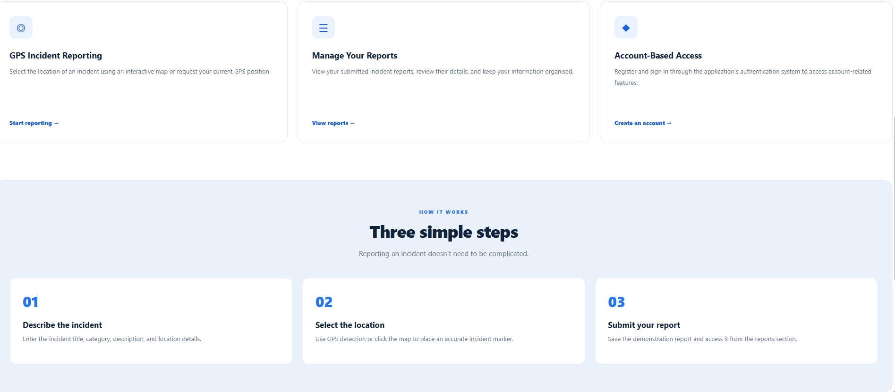
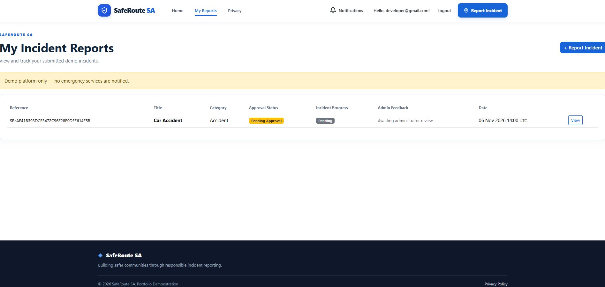
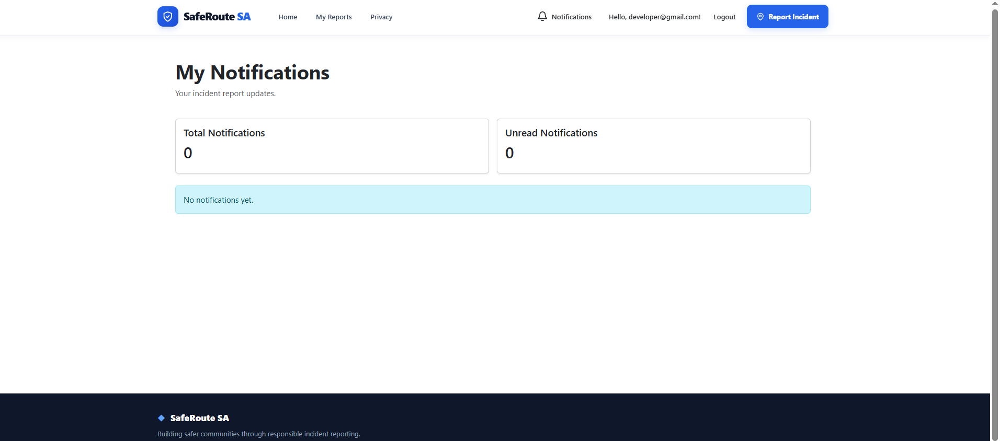
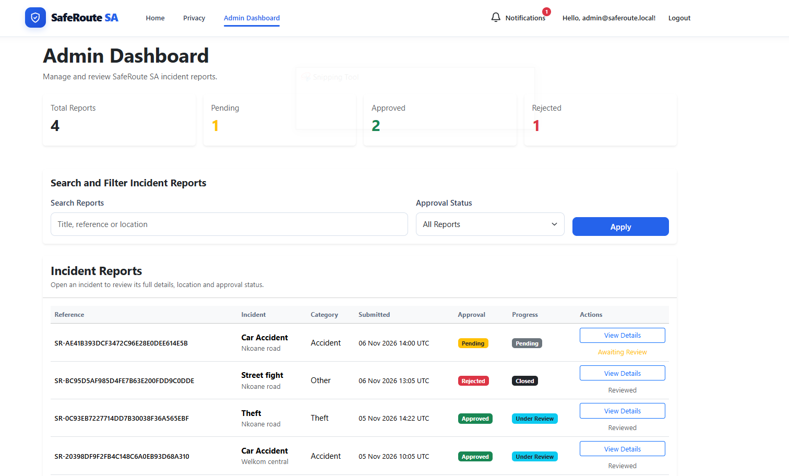

# 🛡️ SafeRoute SA

### Community Safety & Incident Reporting Management System

**SafeRoute SA** is a web-based community safety and incident reporting application developed using **ASP.NET Core MVC, C#, Entity Framework Core and SQL Server**.

The platform allows registered users to report incidents, provide location information, track their submissions and receive notifications about administrative decisions.

Administrators can review submitted incidents, search and filter reports, approve or reject submissions, and manage the incident review process.

The project demonstrates practical full-stack web development skills, including authentication, role-based authorization, database management, server-side validation and responsive user interfaces.

---

## 🚀 Key Features

### 👤 User Features

- User registration and login using ASP.NET Core Identity
- Secure authentication and account management
- Submit incident reports with titles, descriptions and categories
- Capture incident GPS coordinates
- Display incident locations using interactive maps
- View personal incident reports
- Track incident approval and progress statuses
- Receive notifications when reports are approved or rejected
- View notifications and mark them as read

### 🛡️ Administrator Features

- Secure administrator dashboard
- Role-based access control
- View submitted incident reports
- Search reports by title, reference number or location
- Filter reports by approval status
- View incident details and mapped locations
- Approve or reject pending reports
- Record administrator review notes
- View report statistics
- Receive notifications when users submit new reports

### 🔔 Notification System

SafeRoute SA includes a database-backed in-app notification system.

| Event | Recipient |
|---|---|
| New incident submitted | Administrator |
| Incident approved | Reporting user |
| Incident rejected | Reporting user |

Notifications include read/unread tracking, an unread counter in the navigation bar and links to related incident reports.

---

## 🛠️ Technologies Used

| Technology | Purpose |
|---|---|
| C# | Backend development |
| ASP.NET Core MVC (.NET 10) | Web application framework |
| Entity Framework Core | Object-relational mapping |
| SQL Server LocalDB | Relational database |
| ASP.NET Core Identity | Authentication and user management |
| Razor Views | Dynamic server-rendered pages |
| HTML5 | Page structure |
| CSS3 | Styling and layouts |
| Bootstrap | Responsive interface |
| JavaScript | Client-side functionality |
| Leaflet.js | Interactive maps |
| Git & GitHub | Version control |

---

## 🏗️ Application Architecture

The application follows the **Model-View-Controller (MVC)** architectural pattern.

**Models:** Define incident reports, notifications and their associated data structures.

**Views:** Provide the user interface using Razor, HTML, CSS and Bootstrap.

**Controllers:** Handle requests, enforce access rules and coordinate application operations.

**Entity Framework Core:** Manages database access, relationships and migrations.

**ASP.NET Core Identity:** Handles account authentication and role-based authorization.

### Main Application Components

```text
SafeRouteSA/
│
├── SafeRouteSA.Web/
│   ├── Areas/
│   │   └── Identity/
│   ├── Controllers/
│   │   ├── AdminController.cs
│   │   ├── HomeController.cs
│   │   ├── IncidentsController.cs
│   │   └── NotificationsController.cs
│   ├── Data/
│   │   └── ApplicationDbContext.cs
│   ├── Models/
│   │   ├── Incident.cs
│   │   └── Notification.cs
│   ├── ViewModels/
│   ├── Views/
│   │   ├── Admin/
│   │   ├── Home/
│   │   ├── Incidents/
│   │   ├── Notifications/
│   │   └── Shared/
│   ├── Migrations/
│   ├── wwwroot/
│   ├── Program.cs
│   └── appsettings.json
│
├── SafeRouteSA.slnx
└── README.md
```

---

## 🔄 Incident Reporting Workflow

1. A user registers or signs in.
2. The user submits an incident report with the required information and location.
3. The system generates a unique reference number.
4. The incident is saved with a **Pending** approval status.
5. Administrators receive an in-app notification.
6. An administrator reviews the incident.
7. The administrator approves or rejects the report.
8. The reporting user receives an in-app notification.
9. The user can view the decision and associated review notes.

### Incident Approval Statuses

- **Pending:** Awaiting administrator review.
- **Approved:** Accepted by an administrator.
- **Rejected:** Rejected by an administrator.

### Incident Progress Statuses

The application also defines Pending, Under Review, In Progress, Resolved and Closed incident progress statuses.

---

## 🔐 Security Features

- ASP.NET Core Identity authentication
- Role-based authorization for administrator functions
- User-specific incident and notification access
- Anti-forgery validation for form submissions
- Server-side input validation
- Entity Framework Core database access
- Controlled incident approval and rejection workflow
- Private development credentials through .NET User Secrets

---

## 💻 Getting Started

### Prerequisites

To run SafeRoute SA locally, install:

- .NET 10 SDK
- Visual Studio 2022 with ASP.NET and web development tools, or another compatible .NET development environment
- SQL Server LocalDB or a configured SQL Server instance
- Git

### 1. Clone the repository

```bash
git clone https://github.com/Vincent203-ctrl/SafeRouteSA.git
cd SafeRouteSA/SafeRouteSA.Web
```

### 2. Restore dependencies

```bash
dotnet restore
```

### 3. Configure the database

The application uses SQL Server through the `DefaultConnection` connection string.

For local development, configure the connection in `appsettings.json` or through environment-specific configuration.

Example:

```json
{
  "ConnectionStrings": {
    "DefaultConnection": "Server=(localdb)\\MSSQLLocalDB;Database=SafeRouteSADb;Trusted_Connection=True;MultipleActiveResultSets=true;TrustServerCertificate=True"
  }
}
```

### 4. Apply database migrations

```bash
dotnet tool install --global dotnet-ef --version 10.0.0
dotnet ef database update
```

If `dotnet-ef` is already installed, skip the installation command.

### 5. Run the application

```bash
dotnet run
```

Open the local address displayed in the terminal.

### Administrator Setup

Administrator access requires an account assigned to the `Admin` role.

The development application includes an administrator-seeding configuration that uses .NET User Secrets.

Configure the required values locally:

```bash
dotnet user-secrets set "AdminSeed:Email" "admin@example.local"
dotnet user-secrets set "AdminSeed:Password" "YOUR_STRONG_LOCAL_PASSWORD"
```

Use your own development credentials. Never commit administrator passwords or user-secrets files to GitHub.

Restart the application to allow the configured seeding process to run.

---


## 📸 Application Screenshots

The following screenshots demonstrate the main features of SafeRoute SA.

### 🏠 Homepage


### 🚀 Platform Features


### 📋 My Incident Reports


### 🔔 Notifications


### 🛡️ Administrator Dashboard



## 🎯 Project Objectives

SafeRoute SA was developed to:

- Apply full-stack ASP.NET Core MVC development skills.
- Build a structured incident reporting application.
- Implement secure authentication and role-based access.
- Integrate relational database operations using Entity Framework Core.
- Work with geographic coordinates and interactive mapping.
- Implement administrator approval workflows.
- Build an in-app notification system.
- Demonstrate software development and problem-solving skills through a practical portfolio project.

---

## 🔮 Potential Future Improvements

- Email and push notifications
- Real-time notification delivery using SignalR
- Image uploads for incident evidence
- Incident analytics and reporting charts
- Enhanced location search
- Mobile application integration
- Deployment to a cloud hosting platform

These are proposed enhancements and are not part of the current implementation.

---

## 👨‍💻 Developer

**Sinekhaya Vatsha**

Junior C# / .NET and Flutter Developer

Diploma in Information Technology — Central University of Technology

**GitHub:** [Vincent203-ctrl](https://github.com/Vincent203-ctrl)

**Project:** [SafeRoute SA](https://github.com/Vincent203-ctrl/SafeRouteSA)

---

## 📄 Project Status

**Portfolio project — locally developed and tested.**

SafeRoute SA demonstrates practical experience with ASP.NET Core MVC, C#, SQL Server, Entity Framework Core, authentication, role-based authorization, interactive mapping and notification workflows.

*SafeRoute SA is a software development demonstration project, not an official emergency response or dispatch service.*
